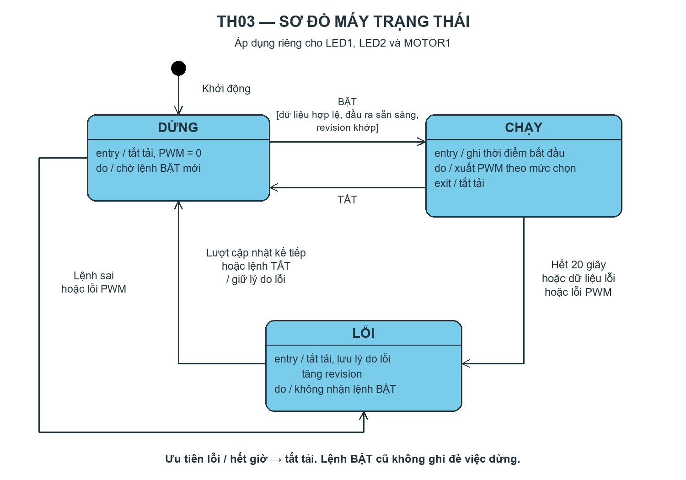

# Bài 3 — Điều khiển thiết bị an toàn

## Sơ đồ máy trạng thái

Sơ đồ áp dụng riêng cho LED1, LED2 và MOTOR1, thể hiện giới hạn 20 giây và ưu tiên dừng khi lỗi. MOTOR2 ngoài phạm vi.

## Trạng thái mới nhất — LED1, LED2 và MOTOR1 điều khiển thật

**Điều chỉnh bơm MOTOR1:** web có mức PWM 25%, 50%, 75%, 100% (mặc định 100%). GPIO5/IN1 phát PWM 1 kHz, 8-bit; GPIO17/IN2 giữ LOW. Đổi mức khi đang chạy không khởi động lại giới hạn 20 giây; đổi mức khi đang dừng chỉ lưu lựa chọn, không tự bật bơm. TẮT/lỗi/hết giờ đặt duty 0. Nếu PWM lỗi, đưa GPIO5 về LOW và khóa lệnh chạy kênh bơm. Mức phần trăm là duty điện, không phải lưu lượng đã đo; mức thấp có thể không đủ để bơm khởi động, cần quan sát thực tế. Chưa nạp hoặc kiểm tra bơm trên board.

Người dùng đã xác nhận LED **HIGH bật / LOW tắt**. Đã tích hợp PWM thật trên GPIO13 (LED1/J11) và GPIO12 (LED2/J13): 1 kHz, 8-bit, các mức 25%/50%/90% tương ứng duty 64/128/230 trên thang 255. Tần số là lựa chọn triển khai, chưa đo thực tế. Khởi tạo duty 0 trước Wi-Fi; DỪNG/LỖI/hết giờ đều về duty 0. Nếu attach/write PWM thất bại, kênh bị khóa chạy và đưa chân về LOW. API dùng [LEDC của Arduino-ESP32 3.x](https://docs.espressif.com/projects/arduino-esp32/en/latest/api/ledc.html).

Các mô tả LED mô phỏng ở lịch sử kế hoạch bên dưới đã được thay thế bằng trạng thái này. Hai LED và MOTOR1 đều có đầu ra thật; MOTOR2 tuyệt đối không tác động. Chưa upload hoặc kiểm thử trên board.

Mục này thay thế các ghi chú “chỉ logic/chưa build” ở các bước chuẩn bị cũ bên dưới.

- **MOTOR1 đã có đầu ra thật:** GPIO5=IN1, GPIO17=IN2. BẬT là HIGH/LOW; TẮT, lỗi và hết 20 giây là LOW/LOW (thả trôi, không phanh điện). Khởi tạo cả hai ở LOW trước Serial, I²C và Wi-Fi. Chiều quay thực tế phụ thuộc dây động cơ.
- LED1/LED2 xuất PWM active-HIGH tại GPIO13/12. MOTOR2/GPIO23/GPIO22/J10 tuyệt đối không tác động.
- Timer phần cứng phát ngắt mỗi 1 giây. ISR chỉ tăng bộ đếm trong critical section; vòng lặp đọc bộ đếm và in log. `handled_at_ms` là thời điểm xử lý ngoài ISR, không phải phép đo chính xác chu kỳ ngắt. API trả `timerReady`, `timerTicks`.
- Máy trạng thái và timeout 20 giây vẫn kiểm tra bằng `millis()` trong vòng lặp, không phụ thuộc tick 1 giây. WebServer/I²C đồng bộ có thể gây trễ xử lý; đây không phải mạch ngắt khẩn cấp độc lập. Chưa có số đo độ trễ thực tế.
- Web ghi rõ cả ba kênh điều khiển thật. API có `hardwareEnabled` riêng từng kênh; LED trả false nếu PWM gặp lỗi. Trạng thái chỉ xác nhận lệnh xuất, không xác nhận phản ứng vật lý của tải.
- Build thành công với Espressif32 8.0.0 / Arduino-ESP32 3.3.12; platform được khóa trong `platformio.ini`. Chưa nạp firmware, chưa kiểm tra tải thật hoặc đo chu kỳ timer.

Tài liệu: [bảng điều khiển A4950, trang 4–5](https://www.allegromicro.com/-/media/files/datasheets/a4950-datasheet.ashx), [API timer Espressif](https://docs.espressif.com/projects/arduino-esp32/en/latest/api/timer.html).

Học phần: CSE3069 · Phát triển ứng dụng IoT  
Họ tên: [Bổ sung] · MSSV: [Bổ sung] · Nhóm: [Bổ sung]

## Cấu hình đã thống nhất với người dùng

Phần này cập nhật và được ưu tiên so với các lựa chọn dự kiến trong checklist bên dưới. Đã tạo dự án PlatformIO và firmware nền nhận I²C; **chưa triển khai giao diện web hoặc điều khiển tải**.

- Web có ba phần điều khiển riêng: **LED1, LED2 và MOTOR1**.
- LED1: J11, GPIO13, net `ARRAY_LED3`; LED2: J13, GPIO12, net `ARRAY_LED4`, theo PDF. Người dùng xác nhận cần điều khiển cả hai LED.
- MOTOR1: J9, IN1=GPIO5, IN2=GPIO17. Tuyệt đối không sử dụng MOTOR2.
- UNO đọc cảm biến và gửi dữ liệu cho ESP32; ESP32 không đọc DHT11 trực tiếp trong phương án này.
- Đường truyền UNO–ESP32 là I²C: UNO A4 ↔ ESP32 GPIO33 (SDA), UNO A5 ↔ ESP32 GPIO32 (SCL), GND ↔ GND.
- ESP32 là **I²C master**; UNO là **slave tại địa chỉ `0x08`**. ESP32 yêu cầu **4 byte mỗi 2 giây**, UNO phản hồi dữ liệu. Quy ước giải mã được người dùng chọn ở bước 1 bên dưới, chưa được xác minh từ firmware UNO.
- Môi trường triển khai: **PlatformIO**.
- Theo người dùng, thầy đã kiểm tra phần cứng và tải đang hoạt động bình thường; chưa có thông số định mức hoặc số đo được cung cấp. Không ghi điều này thành kết quả ba ca thử TH03.
- Có thể bỏ phần ngắt bằng nút vật lý theo xác nhận của người dùng; nút điều khiển nằm trên web. Vẫn thực hiện timer phần cứng và PWM; không gọi sự kiện web là ISR GPIO.

**Còn cần xác định trước khi điều khiển tải:** cực tính điều khiển LED, cách dừng MOTOR1 và giới hạn chạy cho từng tải. Cách UNO mã hóa lỗi cảm biến, giá trị âm và ngưỡng mất dữ liệu cũng chưa được xác nhận. Không ghi các giả định là cấu hình đã kiểm chứng.

## Bước 1 — Chốt cấu hình và quy ước dữ liệu

Đã cập nhật tài liệu theo lựa chọn của người dùng và tạo dự án PlatformIO nền. Chưa có giao diện web hoặc điều khiển tải.

| Thành phần | Cấu hình triển khai |
| --- | --- |
| LED1 | GPIO13 → U11/Q10 → J11; net ARRAY_LED3 |
| LED2 | GPIO12 → U12/Q11 → J13; net ARRAY_LED4 |
| MOTOR1 | GPIO5 (IN1), GPIO17 (IN2) → U9 → J9 |
| Giao diện | Ba phần điều khiển riêng LED1, LED2, MOTOR1 |
| Dữ liệu cảm biến | UNO đọc; ESP32 yêu cầu qua I²C |
| I²C | SDA=GPIO33 ↔ A4; SCL=GPIO32 ↔ A5; GND chung |
| Vai trò / chu kỳ | ESP32 master, UNO slave 0x08, đọc 4 byte mỗi 2 giây |
| Môi trường | PlatformIO; phiên bản framework sẽ được chọn khi tạo dự án |

### Quy ước giải mã được chọn

**Giả định triển khai do người dùng chấp thuận, không phải giao thức đã được xác minh:** hai trường 16-bit, byte cao trước, chia 10; trường đầu là nhiệt độ °C, trường sau là độ ẩm %RH. Tạm tính các byte là số không dấu; chưa xác định cách UNO biểu diễn nhiệt độ âm hoặc mã lỗi.

| Vị trí byte (từ 0) | Ý nghĩa giả định |
| --- | --- |
| 0 | Byte cao của nhiệt độ × 10 |
| 1 | Byte thấp của nhiệt độ × 10 |
| 2 | Byte cao của độ ẩm × 10 |
| 3 | Byte thấp của độ ẩm × 10 |

- Nhiệt độ = (byte 0 × 256 + byte 1) / 10.
- Độ ẩm = (byte 2 × 256 + byte 3) / 10.
- Gói đã nhận `01 05 01 D6`: nhiệt độ = 261 / 10 = **26,1°C**; độ ẩm = 470 / 10 = **47,0%RH**, theo giả định trên.

Khi triển khai, cần giữ log cả 4 byte gốc và giá trị giải mã để đối chiếu. Nhận đủ 4 byte chỉ xác nhận độ dài, không chứng minh dữ liệu cảm biến đúng. Gói thiếu byte không được coi là mẫu hợp lệ hoặc làm mới thời điểm nhận mẫu hợp lệ. Chưa dùng một giá trị trông hợp lý làm bằng chứng giao thức đã đúng.

### Trạng thái hoàn thành bước 1

- [x] Chốt ba kênh điều khiển, chân kết nối và PlatformIO.
- [x] Ghi cấu hình I²C và giả định giải mã người dùng chọn.
- [x] Giữ ràng buộc tuyệt đối không tác động MOTOR2/GPIO23/GPIO22/J10.
- [ ] Xác nhận mức BẬT/TẮT của driver LED và tổ hợp IN1/IN2 dùng để dừng MOTOR1 trước khi điều khiển tải.
- [ ] Chốt giới hạn chạy từng kênh và ngưỡng dữ liệu quá cũ; 20 giây trong kế hoạch bên dưới vẫn là giá trị dự kiến.

Đã tạo dự án theo yêu cầu người dùng, bỏ qua bước chạy kiểm tra. Chưa build, upload hoặc thử trên board; không có kết quả kiểm thử phần cứng.

## Dự án PlatformIO hiện tại

| File | Nội dung |
| --- | --- |
| `platformio.ini` | ESP32 Dev Module (`esp32dev`), Arduino framework, Serial 115200 |
| `include/project_config.h` | SDA/SCL, địa chỉ UNO, kích thước gói và chu kỳ đọc |
| `src/main.cpp` | Khởi tạo I²C, đọc định kỳ, in HEX và giá trị giải mã giả định, báo thiếu byte |
| `.gitignore` | Bỏ qua sản phẩm build và thư mục tạm |

Tần số I²C khởi tạo là 100 kHz, timeout giao dịch 50 ms: đây là giá trị cấu hình chọn cho dự án mới, không phải thông số đã xác nhận từ code cũ. Lập lịch đọc bằng `millis()`, không dùng `delay()` dài. Không khai báo hoặc thao tác chân tải; không có thao tác MOTOR2. Phần đọc I²C vẫn là giao dịch đồng bộ có timeout.

Mở thư mục này bằng VS Code + PlatformIO. Khi cần, dùng `pio run` để build, `pio run --target upload` để nạp và `pio device monitor` để xem Serial. Các lệnh này **chưa được chạy**. Phiên bản platform chưa khóa; PlatformIO sẽ giải quyết gói `espressif32` khi build lần đầu.

Tham khảo cấu hình [board esp32dev của PlatformIO](https://docs.platformio.org/en/stable/boards/espressif32/esp32dev.html) và [API I²C Arduino-ESP32](https://docs.espressif.com/projects/arduino-esp32/en/latest/api/i2c.html).

## Mục tiêu và phạm vi

> **RÀNG BUỘC BẮT BUỘC: TUYỆT ĐỐI KHÔNG CODE HAY ĐỤNG CHẠM VÀO MOTOR2.** Không viết code điều khiển, không khởi tạo/cấu hình/đọc/ghi GPIO23 hoặc GPIO22 (kể cả đặt LOW, tắt tải, PWM hay thử nghiệm), không đấu nối, tháo dây hoặc tác động đến đầu nối J10 và mạch MOTOR2. Các thao tác khởi tạo an toàn/tắt tải trong tài liệu này chỉ áp dụng cho tải được chọn ngoài MOTOR2. Ràng buộc này áp dụng cho toàn bộ quá trình triển khai và kiểm thử.

Điều khiển máy bơm DC hoặc LED strip trên mô hình nhà kính bằng ESP32 thông qua mạch công suất. Hệ thống có ba trạng thái **DỪNG / CHẠY / LỖI**, tải tắt khi khởi động, khi hết thời gian hoặc khi đầu vào không hợp lệ.

**Thay nút bấm vật lý bằng nút BẬT/TẮT trên giao diện web.** ESP32 phục vụ trang web trong mạng nội bộ và nhận lệnh từ trình duyệt. Việc kiểm tra điều kiện chạy, giới hạn thời gian và tắt tải được thực hiện ngay trên ESP32, không phụ thuộc trang web còn mở hay không.

Đây là kế hoạch thực hiện; đã có firmware nền I²C, chưa có firmware điều khiển tải hoàn chỉnh, sơ đồ PNG hoặc kết quả đo thực tế. Các ô chưa đánh dấu và các mục `[Bổ sung]` cần được hoàn thành trong quá trình làm bài.

> Khác biệt với đề gốc: sự kiện nhấn nút web và callback HTTP không phải ngắt ngoài GPIO. Thí nghiệm lệnh web bên dưới thay cho thao tác nút vật lý, nhưng không chứng minh kỹ năng A7 hoặc phép đo dội tiếp điểm. Cần trao đổi với giảng viên về cách đánh giá phần thay thế này trước khi nộp; không ghi callback web là ISR ngắt ngoài. Timer phần cứng và ISR timer vẫn phải thực hiện.

## File cần có trong repo khi hoàn thành

| File | Nội dung cần chuẩn bị |
| --- | --- |
| `README.md` | Kế hoạch, cấu hình thực tế và câu trả lời 4.1–4.5 |
| `control.ino` | Firmware ESP32: web, FSM, cảm biến, timer phần cứng và PWM |
| `fsm_diagram.png` | Sơ đồ đủ ba trạng thái, điều kiện chuyển và ưu tiên dừng |
| `test_case_1.mp4` | Video bật/tắt bình thường qua web |
| `test_case_2.mp4` | Video tự dừng khi hết thời gian |
| `test_case_3.mp4` | Video về trạng thái an toàn khi dữ liệu lỗi |
| `serial_log.txt` | Log thực tế của cả ba ca thử |

Có thể nhúng HTML/CSS/JavaScript vào firmware để giao diện web được phục vụ trực tiếp từ ESP32. Khi dùng Arduino IDE, đặt sketch trong thư mục tên `control` để mở và biên dịch; giữ bản firmware nộp theo cấu trúc yêu cầu của giảng viên.

## Danh sách công việc

### 1. Xác định và kiểm tra phần cứng

- [ ] Chọn tải: máy bơm DC hoặc LED strip; ghi điện áp và dòng điện định mức.
- [ ] Ghi phiên bản board ESP32, framework và phiên bản Arduino-ESP32 sẽ dùng.
- [ ] Chọn GPIO phù hợp board, tránh chân gây kích hoạt tải khi khởi động.
- [ ] Chọn MOSFET/transistor hoặc module driver phù hợp mức điều khiển và dòng tải; ghi mã linh kiện cụ thể.
- [ ] Vẽ đường điều khiển: GPIO → mạch công suất → tải; ghi nguồn cấp tải và cách nối mass theo mạch sử dụng.
- [ ] Bổ sung điện trở giữ đầu điều khiển ở mức tắt khi reset; với tải cảm như bơm/cuộn relay, có diode dập xung đúng chiều và đúng định mức.
- [ ] Không nối trực tiếp bơm hoặc cuộn relay vào GPIO. Không dùng relay cơ để thử PWM.
- [ ] Nhờ giảng viên kiểm tra đường điều khiển **trước khi cấp điện cho tải**.
- [ ] Sau khi được kiểm tra, xác minh tải tắt khi cấp nguồn/reset, kể cả trước khi có firmware điều khiển; ghi quan sát thực tế.
- [ ] Đo điện áp GPIO ở HIGH/LOW nếu có đồng hồ và ghi kết quả.

### 2. Làm giao diện web thay nút vật lý

- [ ] Kết nối ESP32 vào Wi-Fi nội bộ; in địa chỉ truy cập lên Serial.
- [ ] Tạo trang có nút **BẬT**, **TẮT**, hiển thị DỪNG/CHẠY/LỖI, lý do dừng gần nhất, dữ liệu cảm biến và thời gian chạy còn lại.
- [ ] Tạo lựa chọn PWM 25%, 50%, 90% cho LED hoặc tải được phép thử; giá trị mặc định cần chốt theo tải thực tế.
- [ ] Dự kiến dùng `POST /api/control` cho lệnh `START`/`STOP`, `POST /api/pwm` cho duty và `GET /api/status` cho trạng thái.
- [ ] Kiểm tra định dạng, kiểu dữ liệu và miền giá trị trên ESP32. Lệnh điều khiển sai phải tạo sự kiện lỗi và tắt tải.
- [ ] Callback nhận lệnh chỉ kiểm tra/ghi nhận sự kiện; FSM quyết định đầu ra. Đồng bộ dữ liệu nếu callback và vòng lặp chạy ở các task khác nhau.
- [ ] Chặn gửi BẬT lặp khi đang chờ phản hồi; xử lý lệnh BẬT lặp theo cách không khởi động lại bộ đếm thời gian.
- [ ] Ưu tiên TẮT, lỗi và hết giờ; không để lệnh BẬT đang chờ ghi đè việc dừng.
- [ ] Hiển thị mất kết nối hoặc trạng thái chưa xác nhận khi web không nhận được phản hồi, không tự báo tải đã bật/tắt.
- [ ] Kiểm tra đóng trang hoặc mất mạng không làm vô hiệu giới hạn chạy trên ESP32; không tự chạy lại khi kết nối phục hồi.

### 3. Thí nghiệm nút web và chống lệnh lặp

Phần này đo sự kiện web thay cho dội tiếp điểm. Có thể dùng khóa nút khi đang gửi và mã yêu cầu để nhận diện yêu cầu trùng. Cơ chế chống lặp không được trì hoãn lệnh TẮT.

- [ ] Bấm 10 lần rõ ràng, ghi số thao tác, số yêu cầu ESP32 nhận và số lệnh hợp lệ được xử lý.
- [ ] Thử nhấn nhanh hoặc gửi lại cùng yêu cầu trước và sau khi thêm cơ chế chống lặp.
- [ ] Lặp lại khi ESP32 đang đọc cảm biến theo lịch; ghi số yêu cầu nhận được và độ trễ phản hồi.
- [ ] Không dùng vòng chờ hoặc `delay()` dài làm web và kiểm tra dừng bị đình trệ.
- [ ] Ghi rõ kết quả này không phải số lần ISR ngắt ngoài được gọi.

### 4. Thí nghiệm timer phần cứng và PWM

- [ ] Chọn API timer/PWM đúng với phiên bản chip và framework đã ghi.
- [ ] Dự kiến chu kỳ timer **1.000 ms**; ISR chỉ cập nhật cờ/bộ đếm, không in Serial, không `delay()`, không xử lý web.
- [ ] Đọc cờ/bộ đếm an toàn ở vòng lặp chính và xử lý công việc bên ngoài ISR.
- [ ] Đo chu kỳ thực tế, ghi phương pháp đo và sai lệch; phân biệt thời điểm timer phát sự kiện với thời điểm vòng lặp xử lý/in log.
- [ ] So sánh độ ổn định với cách lập lịch bằng `millis()` của Bài 2 trong cùng điều kiện tải xử lý.
- [ ] Chọn và ghi tần số PWM phù hợp tải; thử duty 25%, 50%, 90%, chụp ảnh hoặc ghi quan sát thực tế.

### 5. Dựng máy trạng thái an toàn

Giới hạn chạy dự kiến: **20 giây mỗi lần bật**, thuộc khoảng 10–30 giây của đề. Điều chỉnh nếu cơ cấu thực tế yêu cầu và cập nhật lại README.

| Trạng thái | Đầu ra | Điều kiện chuyển |
| --- | --- | --- |
| DỪNG | Tải tắt, PWM = 0 | Lệnh BẬT mới và đầu vào hợp lệ → CHẠY |
| CHẠY | Tải chạy ở duty đã chọn | TẮT → DỪNG; hết 20 giây hoặc input lỗi → LỖI |
| LỖI | Tắt tải ngay, ghi nguyên nhân | Xóa lệnh BẬT đang chờ → DỪNG, giữ lý do lỗi để hiển thị |

- [ ] Khởi tạo đầu ra tắt trước khi khởi tạo mạng và các chức năng khác.
- [ ] Viết `updateState()` gọi mỗi vòng lặp, không dùng `delay()` trong hàm.
- [ ] Dùng hiệu thời gian không dấu từ `millis()` để kiểm tra giới hạn, xử lý được tràn bộ đếm.
- [ ] Kiểm tra lỗi/hết giờ/TẮT trước lệnh BẬT và kết thúc lượt xử lý sau khi dừng.
- [ ] Không đặt lại mốc thời gian khi nhận BẬT lặp hoặc đổi duty trong lúc CHẠY.
- [ ] Cảm biến chưa có mẫu hợp lệ, trả `NaN`, ngoài miền cho phép hoặc dữ liệu quá cũ phải ngăn chạy; chốt ngưỡng theo loại cảm biến thực tế.
- [ ] Sau lỗi/hết giờ, chỉ chạy lại khi có lệnh BẬT mới và đầu vào đã hợp lệ; không tự chạy lại từ lệnh cũ.
- [ ] Xuất sơ đồ thành `fsm_diagram.png` và đối chiếu với firmware.

### 6. Chạy thử và thu minh chứng

| Ca | Thao tác | Kỳ vọng | Quan sát / kết luận |
| --- | --- | --- | --- |
| 1 — Bình thường | Đầu vào hợp lệ, bấm BẬT trên web, sau đó TẮT trước 20 giây | DỪNG → CHẠY → DỪNG; tải theo đúng trạng thái | Chưa thử |
| 2 — Hết giờ | Bấm BẬT, không gửi TẮT, chờ đủ 20 giây | Tắt tải, ghi lý do hết giờ, về DỪNG; BẬT lặp không kéo dài thời gian | Chưa thử |
| 3 — Dữ liệu lỗi | Khi CHẠY, gửi lệnh điều khiển sai định dạng hoặc tạo mẫu cảm biến không hợp lệ | Tắt tải, ghi LỖI → DỪNG; không bị lệnh BẬT ghi đè | Chưa thử |

- [ ] Quay mỗi ca trên mô hình nhà kính, thấy được thao tác web và phản ứng của tải.
- [ ] Lưu Serial có thời gian, lệnh/đầu vào, trạng thái cũ/mới, lý do dừng và duty.
- [ ] Ghi đạt/không đạt theo quan sát thực tế; nếu chưa đạt, ghi nguyên nhân, cách sửa và lần thử lại.
- [ ] Thử thêm reset nguồn, BẬT liên tiếp, BẬT và TẮT gần nhau, mất kết nối web và lỗi đầu vào trong khi CHẠY.

## 4.1 Cấu hình phần cứng

[Bổ sung sau khi chọn phần cứng] Board ESP32: …; phiên bản framework: …; tải: …; GPIO điều khiển: …; linh kiện trung gian/module và mã linh kiện: …; nguồn tải: …; cảm biến và chân kết nối: …; mức kích hoạt: …. Mô tả đường đấu nối và biện pháp giữ tải tắt khi reset. Ghi trạng thái tải thực sự quan sát được khi vừa cấp nguồn trước khi nạp firmware điều khiển, thời điểm giảng viên kiểm tra và điện áp HIGH/LOW nếu đã đo.

## 4.2 Ngắt ngoài — điều chỉnh sang nút web

Theo phương án này, nút vật lý được thay bằng nút web nên không có ISR ngắt ngoài từ nút nhấn. Callback HTTP nhận yêu cầu và chuyển sự kiện cho FSM; việc này không tương đương ISR GPIO. [Bổ sung] Mô tả cơ chế chống lệnh lặp đã triển khai và kết quả thử khi chương trình đang đọc cảm biến.

## 4.3 Timer phần cứng và PWM

Chu kỳ timer dự kiến là 1.000 ms; ISR timer chỉ cập nhật cờ/bộ đếm. [Bổ sung] Ghi chu kỳ đã cấu hình, dụng cụ/phương pháp đo, số mẫu, chu kỳ trung bình, nhỏ nhất/lớn nhất và so sánh với `millis()`. Sai lệch tuyệt đối = |chu kỳ đo − chu kỳ đặt|; sai lệch phần trăm = sai lệch tuyệt đối / chu kỳ đặt × 100%.

